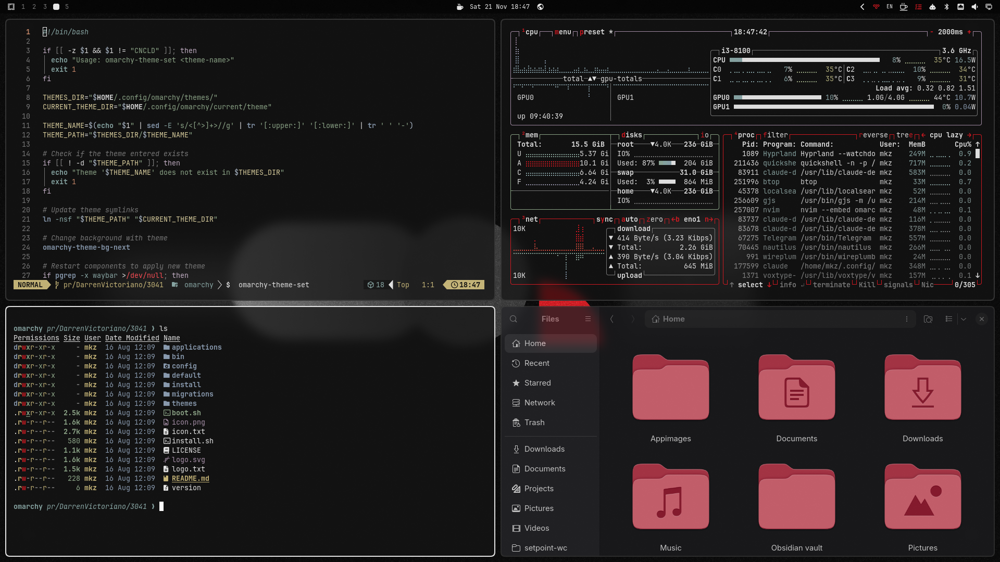
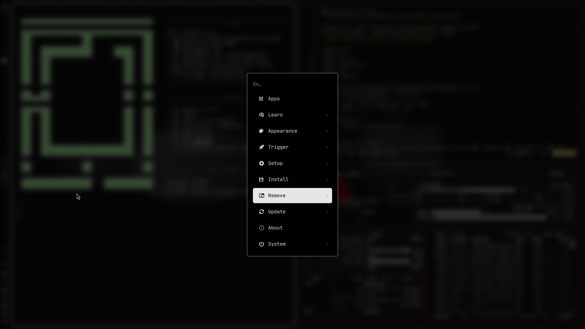
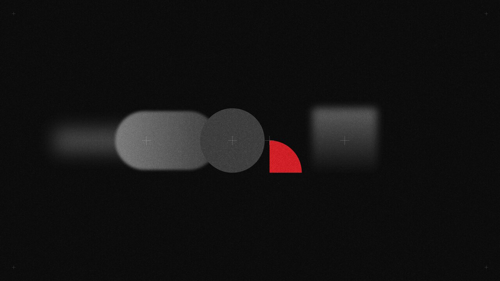
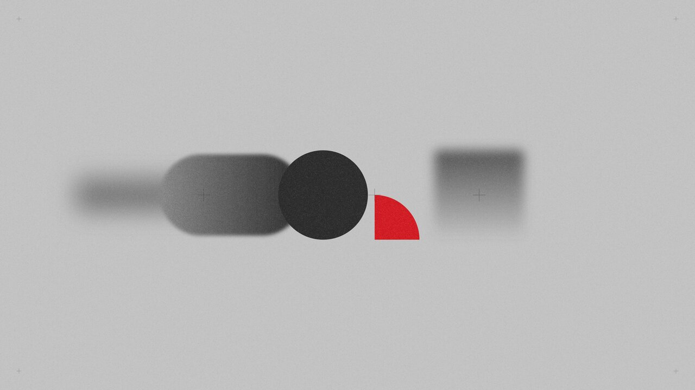
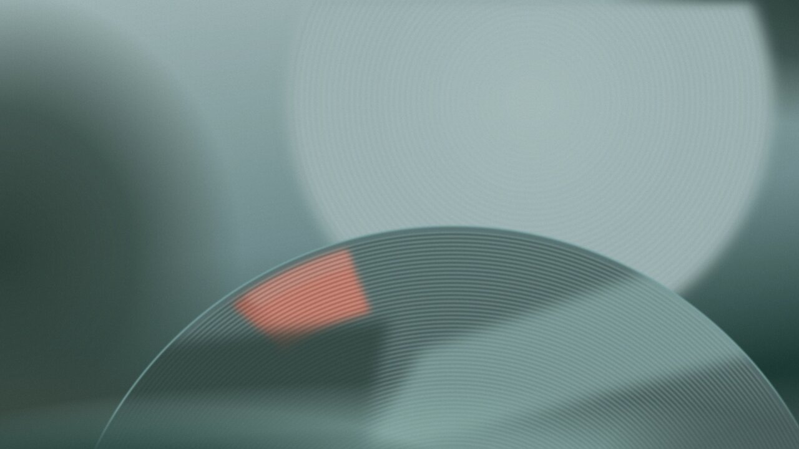
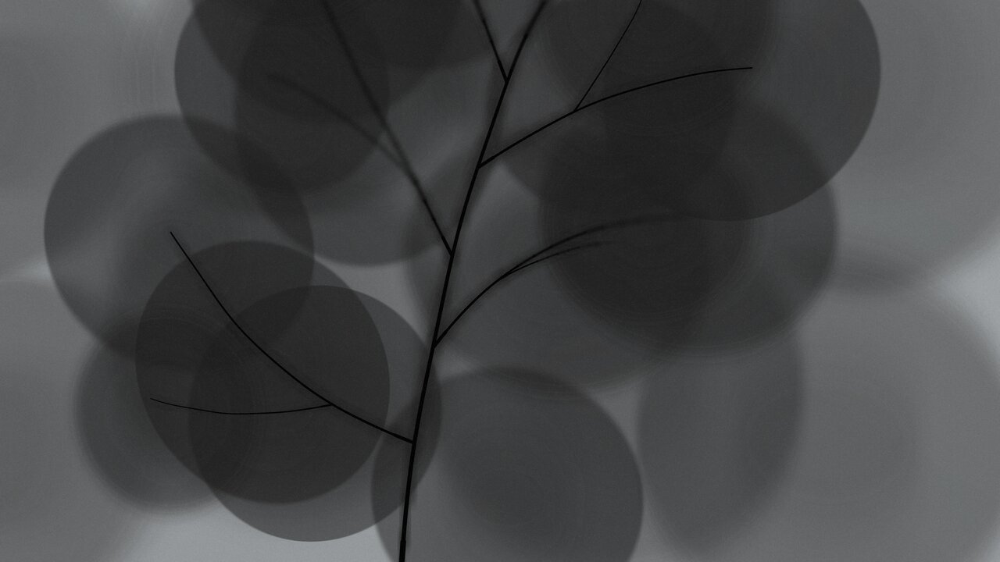
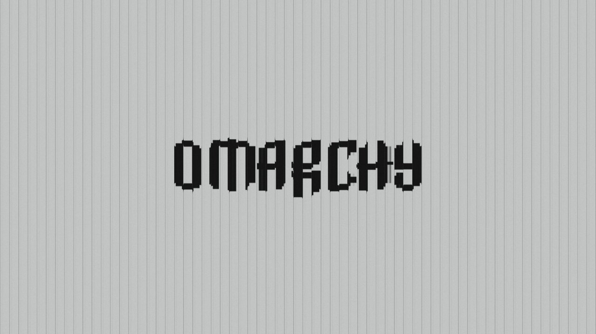
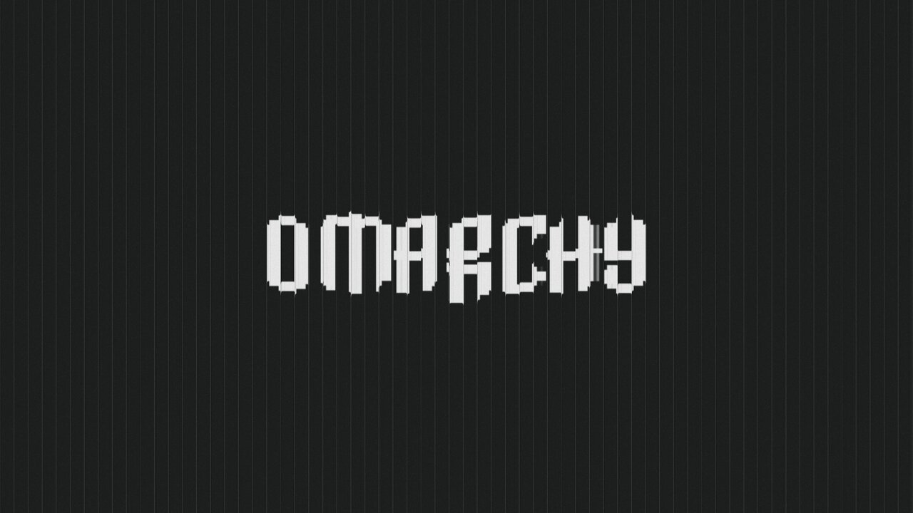

# Null

Black, white and one signal red. A dark theme for Omarchy built on dot-matrix
details, film grain and a strict rule: **red means exactly one thing: look here.**



## Install

For **Omarchy 4 with Omarchy Shell**:

```sh
omarchy theme install https://github.com/mlive1992/omarchy-null-theme
```

Use `omarchy theme bg next` to switch between the six wallpapers.

## Update

```sh
omarchy theme update
```

## Remove

```sh
omarchy theme remove null
```

## The theme

- True-black surfaces, a solid black bar and 1px white window edges.
- **Inverted selection**: the highlighted row in the launcher, menus and the terminal is a white block with black text.
- Signal red `#d71921` only for what needs you: bar alerts, the focused control, the notification countdown, errors.
- Terminal colors greyed down so red is the only one that stands out, while code stays readable.
- Red Yaru folder icons (`Yaru-red-dark`).
- A dot-matrix boot screen: pick it in the Omarchy menu under Style → Unlock.
- Application configs derive from `colors.toml` through Omarchy templates.



## Wallpapers

Six original **5120 × 2880** wallpapers:

| | |
|---|---|
|  Form Study (default) |  Form Study, light |
|  Groove |  Branch |
|  Reeded |  Reeded, dark |

### Intro

The default wallpaper opens with a six-second intro when you switch to Null: the shapes
come into focus one by one and the red signal switches on last, settling on the still.


Turn intros on or off with `omarchy theme bg intro toggle`.

## Fonts

Themes don't set the system font, but Null looks its best with a dot-matrix display
face. Try [Doto](https://fonts.google.com/specimen/Doto) (OFL) for headings and
JetBrains Mono for the terminal: `omarchy font set "JetBrainsMono Nerd Font"`.

## Credits

Inspired by the design language of Nothing OS. Not affiliated with or endorsed by
Nothing Technology Ltd. The boot logo is the Omarchy logo redrawn as dots.

MIT licensed, wallpapers included.
